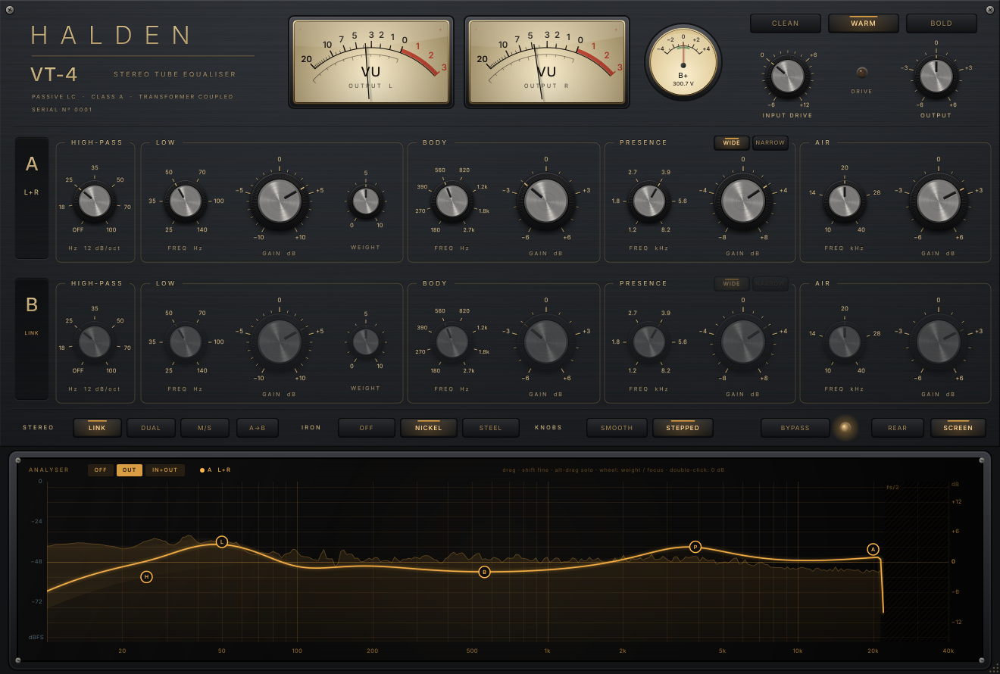

# Halden VT-4: стерео ламповый пассивный LC-эквалайзер

AU / VST3 плагин на JUCE 8 (CMake) для мастер-шины и мастеринга. Это оригинальная схема, а не копия какого-либо прибора. Моделируется весь аппарат целиком, вплоть до блока питания:

- входной трансформатор;
- лампы;
- пассивная LC-цепь;
- выходной каскад с катодным повторителем Уайта;
- выходной трансформатор;
- общий для двух каналов кенотронный выпрямитель с дросселем и RC-фильтрами.

Каждая цепь решается как электрическая схема на каждом сэмпле.



## Схема

```
вход ─ T1 (никель, 1:1) ─┬─ [M/S] ─ канал A ─┬─ [M/S] ─ T2 (никель / сталь) ─ выход
                         └──────── канал B ──┘

канал:  пэд ─ 5751 (общий катод, режим CLEAN/WARM/BOLD) ─ RC-RC HPF
        ─ 6922 катодный повторитель ─ пассивная LC-цепь (−13,5 дБ)
        ─ 5751 + повторитель Уайта 6922 с обратной связью с обмотки T2

питание (общее): GZ34 или кремний ─ 47 мкФ ─ дроссель 10 Гн ─ 220 мкФ = B+
                 RC-развязки 8k2/6k8/470 Ом по 100 мкФ на каждый каскад
```

Вся цепь работает на частоте не ниже 176,4 кГц: 4× оверсемплинг на 44,1 и 48 кГц, 2× на 88,2 и 96 кГц.

- **Лампы.** Модель Корена с сеточным током, параметры подогнаны по паспортам 5751 и 6922. Ток каждой лампы реально нагружает блок питания, поэтому B+ проседает с музыкой, а пульсации 100/120 Гц, оставшиеся после дросселя и RC-фильтров, доходят до анодов.
- **Пассивная цепь.** Каждая полоса подключена к общему узлу через свой ступенчатый пэд постоянного сопротивления и LC-ветвь. Отсюда:
  - полосы взаимодействуют друг с другом, как в железе;
  - добротность почти не зависит от усиления;
  - на подъём и на срез работают разные отводы катушки (центральный фиксатор).
- **Трансформаторы.** Поток считается как интеграл напряжения. Ток намагничивания задан кривой с коленом насыщения и гистерезисом по закону Рэлея (модель Прейзаха из 24 стоп-операторов). Отсюда 3-я гармоника, которая растёт к басу и падает пропорционально уровню: это и есть «объём» железа. **IRON OFF** убирает только нелинейность, АЧХ остаётся та же.
- **Экземпляр прибора.** У каждой детали каждого канала свой допуск, и у каждого серийного номера свой набор деталей и ламп. Поэтому L и R немного различаются, как у настоящего аппарата.

## Панель

| Элемент | Что делает |
|---|---|
| CLEAN / WARM / BOLD | Режим входной лампы (развязка катода, ток, обратная связь) и выпрямитель: CLEAN на кремнии, WARM и BOLD на GZ34. |
| INPUT DRIVE | Раскачка от −6 до +12 дБ с автоматической компенсацией громкости: меняется окраска, а не уровень. |
| DRIVE (лампа) | Загорается, когда появляется сеточный ток. |
| OUTPUT | Выходной уровень, ±6 дБ. |
| VU L / R | Стрелочные индикаторы, 0 VU = синус −18 dBFS. Баллистика по IEC 60268-17. |
| B+ | Отклонение главного анодного напряжения от номинала, ±4 В: просадка и прогрев видны глазом. |
| HIGH-PASS | OFF / 18 / 25 / 35 / 50 / 70 / 100 Гц, 12 дБ/окт, RC-RC между каскадами. |
| LOW | Полка 25 / 35 / 50 / 70 / 100 / 140 Гц, ±10 дБ. **WEIGHT** 0–10 добавляет резонанс: «горб» на 0,8·f и «провал» на 2,2·f. |
| BODY | Очень широкий колокол, около 2,5 октавы: 180 Гц – 2,7 кГц, ±6 дБ. |
| PRESENCE | Колокол 1,2–8,2 кГц, ±8 дБ, добротность **WIDE / NARROW**. |
| AIR | Полка 10 / 14 / 20 / 28 / 40 кГц, ±6 дБ. |
| STEREO | **LINK** (один ряд ручек на оба канала), **DUAL** (L и R раздельно) или **M/S** (середина и бока). **A→B** копирует ряд A в ряд B. |
| IRON | Сердечник выходного трансформатора: **NICKEL** (пермаллой) или **STEEL** (больше «железа» на басу). **OFF** делает оба трансформатора линейными, АЧХ при этом не меняется. |
| KNOBS | **STEPPED**: ручки щёлкают по позициям, усиление шагом 0,5 дБ. **SMOOTH**: плавно, частота между позициями интерполируется. |
| BYPASS | Обход с выравниванием по латентности, бит-в-бит. |
| REAR | Задняя панель (ниже). |
| SCREEN | Показать или скрыть экран. |

**Задняя панель:**
- сеть 50/60 Гц;
- выпрямитель AUTO / GZ34 / кремний;
- накал DC/AC (AC даёт фон около −95 dBFS);
- прогрев при загрузке: лампы и кенотрон разогреваются 4–8 секунд, звук нарастает вместе с B+;
- лампы MATCHED / RANDOM;
- TOLERANCE 0–200 % (разброс деталей);
- NOISE & HUM;
- импеданс источника для входного трансформатора 50 / 150 / 600 Ом;
- серийный номер. Каждый номер даёт свой экземпляр прибора, NEW UNIT выбирает случайный.

## Экран

- **Кривая.** Это настоящая малосигнальная передаточная функция цифровой модели, включая фильтры оверсемплинга, а не рисунок «похожей» кривой. Толстая линия показывает суммарный отклик, полупрозрачные заливки показывают вклад каждой полосы. На 44,1 кГц кривая честно заканчивается на fs/2 со спадом фильтров передискретизации.
- **Анализатор** OFF / OUT / IN+OUT:
  - калиброван: синус 0 dBFS показывает 0 дБ;
  - окно Блэкмана–Харриса;
  - БПФ на 16384 точки для низа и 4096 для верха;
  - интерполяция пиков.
- **Точки H L B P A:**
  - перетаскивание меняет частоту и усиление, с Shift точнее;
  - двойной щелчок даёт 0 дБ;
  - колесо мыши на L меняет WEIGHT, на P переключает FOCUS;
  - ручки и точки связаны в обе стороны.
- **SOLO и DELTA:**
  - Alt + перетаскивание включает временное SOLO, Ctrl/Cmd + Alt включает временное DELTA;
  - значки 🎧 и Δ на ярлыке точки фиксируют режим.
- **DUAL и M/S.** На экране две кривые, переключатель EDIT A / B.

### SOLO и DELTA: что именно слышно

- **Эффект полосы** в контексте остальных: E(f) = 20·lg |H(θ) / H(θ₀)|, где θ₀ означает те же настройки, но с этой полосой в нуле.
- **SOLO** проигрывает выход через окно прослушивания:
  - границы окна стоят там, где |E| падает до половины своего максимума в диапазоне 20 Гц – 20 кГц;
  - при нулевом усилении окно берётся по форме малого подъёма (производной), поэтому оно не прыгает, когда ручка проходит через ноль.
- **Окно** — это фильтр Баттерворта 8-го порядка, собранный из НЧ-прототипа 4-го порядка с предыскажёнными краями:
  - на краях ровно −3,01 дБ, в центре ровно 0 дБ;
  - для LOW, AIR и HPF окно одностороннее (ФНЧ или ФВЧ 4-го порядка);
  - громкость честная, без автоусиления;
  - окно стартует «прогретым» на последних 0,5 с сигнала;
  - включается и выключается за 30 мс по sin²;
  - края плавно следуют за ручками;
  - латентность не меняется;
  - в M/S окно работает на M или на S.
- **DELTA** даёт yΔ = y(θ) − y(θ₀): только то, что полоса добавляет или убирает.
  - Строится как полная копия прибора с тем же состоянием всех ламп, сердечников, конденсаторов и блока питания; в копии полоса за 30 мс плавно уходит в ноль.
  - Поэтому y(θ₀) + yΔ = y(θ) с точностью до округления (стенд: −349 дБ).

## Измерения

Всё ниже измерено стендом `tests/bench.cpp` на том же коде, который работает в плагине, и стендом `tests/plugin_bench.cpp` на самом AudioProcessor (с оверсемплингом). Полные отчёты лежат в `docs/bench-report-linux.txt` и `docs/plugin-bench-report-linux.txt`. Повторить:

```bash
cmake --build build --target vt4_bench vt4_plugin_bench
./build/vt4_bench          # полный прогон, ~3 мин
./build/vt4_plugin_bench_artefacts/Release/vt4_plugin_bench
```

**Точность модели и экрана**

| Что проверяется | Результат |
|---|---|
| Цифровая LC-цепь против аналоговой схемы, 20 Гц – 20 кГц, 172 настройки | ≤ 0,068 дБ на 176,4 кГц, ≤ 0,057 дБ на 192 кГц |
| Пик колоколов BODY и PRESENCE против частоты на шкале | ≤ 0,06 % |
| Закон усиления: шкала против реального усиления полосы | ≤ 0,006 дБ |
| Кривая на экране против реального выхода плагина (−40 dBFS, с оверсемплингом) | ≤ 0,0001 дБ на 44,1 кГц, ≤ 0,0005 дБ на 96 кГц |
| SOLO через плагин: края окна и центр | −3,0103 и 0,0000 дБ; латентность не меняется |
| DELTA: y(θ₀) + yΔ − y(θ) | −349 дБ; DELTA полосы в нуле даёт точную тишину |
| M/S при одинаковых каналах | утечки L→R нет (ниже −240 дБ); M/S совпадает с LINK с точностью 0,00003 дБ |
| IRON OFF против NICKEL, малый сигнал | ≤ 0,0003 дБ во всём диапазоне |
| Анализатор, синусы 31,5 Гц – 15 кГц, 0 / −20 / −60 dBFS | ошибка ≤ 0,03 дБ |

**Звук**

| Что | Результат |
|---|---|
| 3-я гармоника железа, −18 dBFS, 30 Гц | NICKEL −85,3 дБ, STEEL −79,7 дБ, OFF −127,7 дБ |
| То же на 100 Гц / 1 кГц | NICKEL −104 / −127 дБ, STEEL −100 / −126 дБ |
| THD на 1 кГц, −18 dBFS | CLEAN 0,0031 %, WARM 0,037 %, BOLD 0,11 % |
| THD на 1 кГц, 0 dBFS | CLEAN 0,025 %, WARM 0,29 %, BOLD 0,89 % |
| BOLD, DRIVE +12, 0 dBFS | THD 11 % |
| Гармоники | преобладает 2-я: в WARM на −18 dBFS H2 −69 дБ, H3 −115 дБ |
| DRIVE от −6 до +12 дБ (компенсация громкости) | уровень меняется не больше чем на 0,003 дБ |
| Усиление при плоских ручках, 1 кГц | −0,04 дБ |
| Шум, 20 Гц – 20 кГц | CLEAN −100,2, WARM −100,3, BOLD −97,3 dBFS |
| Фон накала в режиме AC | 50 Гц −98,7 dBFS, 150 Гц −110,5 dBFS |
| Остаток пульсаций питания при выключенном NOISE | −124,6 dBFS |
| Фильтры оверсемплинга на 44,1 кГц | 0,00 дБ до 20 кГц, −0,11 дБ на 21 кГц |

**Плагин**

| Что | Результат |
|---|---|
| Латентность | 6 сэмплов на 44,1 и 48 кГц, 4 на 96 кГц, 0 на 192 кГц |
| Bypass | бит-в-бит, с выравниванием по латентности |
| Стресс-тест DSP | 20 с, 19 319 случайных изменений всех параметров, включая 633 смены экземпляра прибора, плюс переключения DELTA и SOLO, квадрат 0 dBFS. NaN нет, пик +11,7 dBFS (предел размаха ламп) |
| Стресс-тест плагина | автоматизация всех параметров, блоки случайной длины 1–512 на 44,1 и 96 кГц: NaN нет |
| Сохранение и восстановление | все 38 параметров совпадают |
| Включение плагина в хосте | `prepareToPlay` занимает меньше 1 мс. Повторное включение (disable / enable) мгновенно, звук совпадает со свежим экземпляром с точностью −133 дБ. Первый запуск и смена частоты строят схему в фоне (около 0,2 с), всё это время вход проходит бит-в-бит |
| Bypass дольше 0,2 с | схема не считается: 0,3 % ядра вместо 32 %. При возврате она стартует из рабочей точки и плавно вводится за 30 мс, без щелчка |
| Санитайзеры | стенд DSP под AddressSanitizer + UBSan: ошибок и утечек нет |
| Настоящий VST3-хост | загрузка, обработка, bypass, состояние, 44,1 и 96 кГц |
| Нагрузка | 26,5 % одного ядра на 44,1 кГц, 29,8 % на 96 кГц (облачный Xeon 2,1 ГГц, стерео, розовый шум) |

## Честные замечания

- **Нагрузка на процессор.** Модель тяжёлая: шесть ламп, четыре трансформатора и блок питания решаются 176 400 раз в секунду. На облачном Xeon 2,1 ГГц это около 27 % одного ядра. Современный Mac или PC примерно вдвое быстрее. Пока включён DELTA, работают две копии прибора, и нагрузка удваивается. В версии 1.0.1 убраны пики нагрузки (смена режима и HPF стоили втрое больше обычного, теперь в полтора раза), вся тяжёлая работа ушла с потоков хоста и интерфейса, а в bypass схема отдыхает. Средняя нагрузка при обработке осталась прежней: снизить её можно только ценой звука (меньший оверсемплинг или упрощённые лампы).
- **TOLERANCE, SERIAL, MATCHED.** Каждая смена строит новый экземпляр прибора с новыми деталями, это около 0,1 с счёта в фоне. Пока ручку крутят, ничего не строится. Новый экземпляр подменяется плавно (30 мс) примерно через 0,1 с после того, как ручку отпустили.
- **Экран показывает линейную часть.** Кривая — это малосигнальный отклик. На громком сигнале в BOLD или с большим DRIVE лампы чуть сжимают звук и добавляют гармоники, и этого кривая не показывает. На −40 dBFS она совпадает с выходом до десятитысячных долей децибела.
- **24 стоп-оператора, а не 32.** Раньше я писал, что гистерезис трансформаторов будет на 32 стоп-операторах. В итоге их 24. Закон Рэлея они воспроизводят так же (цифры 3-й гармоники выше), а процессор нагружают меньше.
- **Каналы L и R немного разные.** Так задумано: разброс деталей при TOLERANCE 100 %. В M/S это даёт утечку L→R около −51 дБ на 1 кГц, как у настоящего прибора. Если нужна идеальная симметрия, поставьте TOLERANCE 0 %.
- **Прогрев.** Он работает только при открытии проекта или вставке плагина. Переключение во время воспроизведения ничего не перезапускает, иначе были бы щелчки.
- **Что проверено здесь.** На Linux проверено всё, что перечислено выше, включая настоящий VST3-хост и снимки интерфейса. Сборки для macOS (Apple Silicon и Intel) и Windows делает GitHub Actions, и там же стенд прогоняется на этих машинах: отчёт лежит в артефакте `bench-report-…`.

## Установка

Готовые плагины собирает GitHub Actions: вкладка **Actions** → последняя сборка → **Artifacts** → `HaldenVT4-macOS` или `HaldenVT4-Windows`. Там же лежит `bench-report-…`, отчёт стенда, прогнанного на машине того же типа.

**macOS** (один файл для Apple Silicon и Intel). Пакеты `.component` и `.vst3` выглядят как файлы, но это папки: копируйте их целиком, внутрь заходить не нужно.

```bash
cp -R "Halden VT-4.component" ~/Library/Audio/Plug-Ins/Components/
cp -R "Halden VT-4.vst3"      ~/Library/Audio/Plug-Ins/VST3/
# сборка без подписи Apple: снять карантин и подписать локально
xattr -cr ~/Library/Audio/Plug-Ins/Components/"Halden VT-4.component" ~/Library/Audio/Plug-Ins/VST3/"Halden VT-4.vst3"
codesign --force --deep -s - ~/Library/Audio/Plug-Ins/Components/"Halden VT-4.component"
codesign --force --deep -s - ~/Library/Audio/Plug-Ins/VST3/"Halden VT-4.vst3"
```

В Logic после этого откройте Plug-in Manager и пересканируйте плагины.

**Windows.** Скопируйте `Halden VT-4.vst3` в `C:\Program Files\Common Files\VST3\`.

## Сборка

Нужны CMake ≥ 3.22 и компилятор C++17. JUCE 8.0.4 скачается сам. Если JUCE уже есть, укажите `-DJUCE_DIR=/путь/к/JUCE`.

```bash
cmake -B build -DCMAKE_BUILD_TYPE=Release
cmake --build build --config Release --target HaldenVT4_All
```

**GitHub Actions:** workflow лежит в `.github/workflows/build.yml`. При загрузке через браузер GitHub пропускает папки, имя которых начинается с точки. Поэтому создайте файл вручную через *Add file → Create new file*, назовите его `.github/workflows/build.yml` и вставьте содержимое из архива (та же копия лежит в `docs/build.yml.txt`).

## Структура

```
Source/dsp/Circuit.h        компилятор схем: узловой метод → дискретная модель (трапеции,
                            предыскажение на элемент, перенос состояния при пересборке)
Source/dsp/Triode.h         лампа (Корен + сеточный ток) и решатель Ньютона с предиктором
Source/dsp/Stages.h         каскады 5751 / 6922 / 5751 + повторитель Уайта
Source/dsp/EqNetwork.h      пассивная LC-цепь, допуски, закон усиления (EqTables.h)
Source/dsp/Magnetics.h      трансформатор: поток, колено, гистерезис Рэлея (стоп-операторы)
Source/dsp/PowerSupply.h    GZ34 / кремний, дроссель, RC-развязки, нагрузка лампами
Source/dsp/Device.h         весь прибор: два канала, M/S, питание, шум, прогрев, экземпляр
Source/dsp/Engine.h         DELTA (копия прибора) и SOLO (окна прослушивания)
Source/dsp/Audition.h       окна SOLO: Баттерворт 8-го порядка, поиск границ
Source/dsp/DisplayModel.h   кривая экрана из самой модели
Source/dsp/Spectrum.h       калиброванный анализатор
Source/ui/                  панель, ручки, стрелочные приборы, экран, задняя панель
tests/bench.cpp             стенд DSP: каждое число из этого README
tests/plugin_bench.cpp      стенд плагина: латентность, bypass, экран, SOLO, CPU, состояние
tools/gen_tables.cpp        генератор EqTables.h (обратный закон усиления полос)
```

## Права

- Код написан с нуля для этого проекта.
- Шрифт Inter распространяется по лицензии SIL Open Font License (`Resources/fonts/OFL.txt`).
- JUCE используется на условиях его лицензии (GPLv3 или коммерческая лицензия JUCE). Подробности в `NOTICE`.
- Обозначения ламп (5751, 6922, GZ34) — это типы радиоламп, а не торговые марки.
